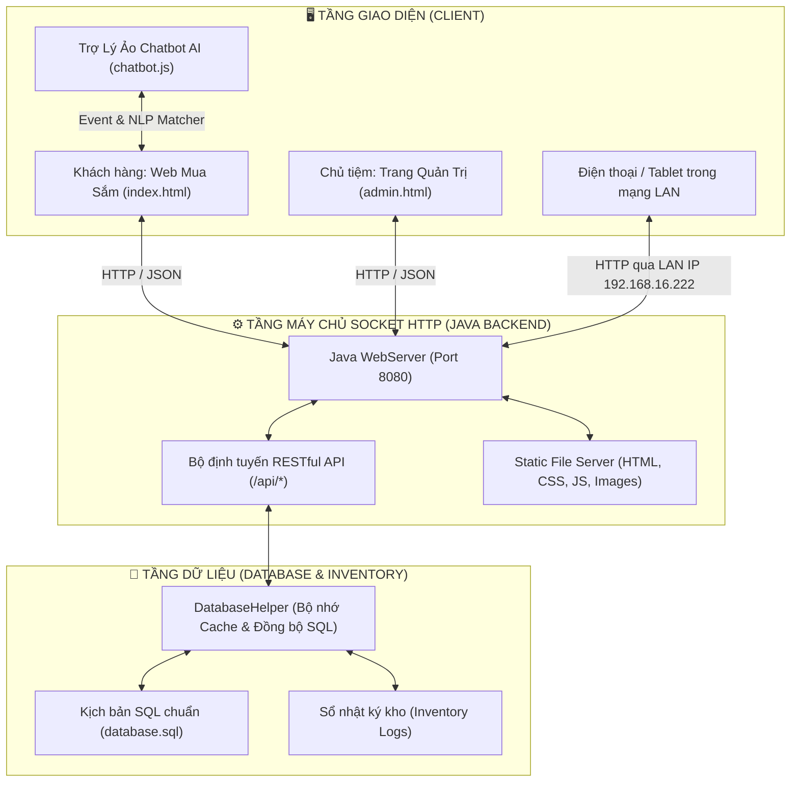

# 📋 BẢN KẾ HOẠCH & HƯỚNG DẪN SỬ DỤNG HỆ THỐNG WEBSITE TIỆM TẠP HÓA

> **Đồ án môn học:** Nhập Môn Mạng Máy Tính / Lập Trình Mạng  
> **Chủ đề:** Xây dựng hệ thống Web Server nội bộ phục vụ bán hàng tiêu dùng & máy tính tiền POS  
> **Chủ tiệm / Quản trị viên:** Phạm Phúc Toàn (`0862.261.874`)  
> **Repository GitHub:** [https://github.com/phamphuctoan12-bot/wed-tap-ho-](https://github.com/phamphuctoan12-bot/wed-tap-ho-)

---

## 🏗️ 1. TỔNG QUAN KIẾN TRÚC HỆ THỐNG



### Thông Số Kỹ Thuật Chính:
* **Ngôn ngữ Backend:** Java (Java SE 17, triển khai bằng Socket HTTP Server thuần không phụ thuộc framework nặng).
* **Mã hóa truyền thông:** UTF-8 toàn diện cho Tiếng Việt có dấu, chuẩn JSON format cho tất cả API.
* **Cổng dịch vụ (Port):** `8080`.
* **Địa chỉ kết nối:**
  * Máy chủ cục bộ: `http://localhost:8080/`
  * Mạng nội bộ LAN (cho thầy cô & máy khác): `http://192.168.16.222:8080/`
  * Tên miền riêng nội bộ: `http://taphoa.local:8080/`
* **Trang quản trị (Admin):**
  * `http://localhost:8080/admin.html` hoặc `http://192.168.16.222:8080/admin.html`
* **Tài khoản Quản Trị Viên:**
  * **Tên đăng nhập:** `phamphuctoan`
  * **Mật khẩu:** `phamphuctoan12@`

---

## 🚀 2. KẾ HOẠCH & QUY TRÌNH KHỞI ĐỘNG HỆ THỐNG

### Bước 1: Khởi động Web Server
Chạy trực tiếp file `run.bat` tại thư mục gốc dự án hoặc chạy dòng lệnh:
```powershell
Set-Location -LiteralPath "d:\nhập môn mạng\WebBanTapHoa"
& "C:\Program Files\Eclipse Adoptium\jdk-17.0.19.10-hotspot\bin\java.exe" "-Dfile.encoding=UTF-8" -cp bin WebServer
```

### Bước 2: Kiểm tra trạng thái máy chủ
* Mở trình duyệt truy cập: `http://localhost:8080/`
* Màn hình chính của **Tiệm Tạp Hóa** hiển thị banner khuyến mãi, 5 danh mục hàng hóa và 25 mặt hàng tiêu dùng.

### Bước 3: Mở cho thiết bị khác trong cùng mạng Wi-Fi (LAN)
* Điện thoại hoặc máy tính của thầy cô kết nối chung mạng Wi-Fi.
* Mở trình duyệt điện thoại gõ: `http://192.168.16.222:8080/` để đặt hàng thử từ xa.

---

## 🛒 3. HƯỚNG DẪN DÀNH CHO KHÁCH HÀNG (CUSTOMER WORKFLOW)

### 3.1. Tìm kiếm & Lọc mặt hàng
1. **Lọc theo danh mục:**
   * Bấm vào các nút danh mục nhanh:
     * 🍜 **Mì gói & Thực phẩm khô** (Hảo Hảo, Omachi, Phở Đệ Nhất, Gạo ST25 Ông Cua 5kg)
     * 🍺 **Góc Bia & Nước** (Bia Larue, Tiger Crystal, Heineken Silver, Bia Sài Gòn, Vang Đà Lạt, Vodka Hà Nội, Soju Jinro, Coca, Sting, Vinamilk, Lavie)
     * 🧂 **Gia vị & Dầu ăn** (Simply, Nam Ngư, Knorr, Tam Thái Tử)
     * 🍪 **Bánh kẹo & Snack** (ChocoPie, Cosy, OStar)
     * 🧼 **Hóa phẩm & Gia dụng** (OMO Matic 3.6kg, Nước rửa chén Sunlight, Lau sàn Sunlight)
2. **Tìm kiếm từ khóa:**
   * Gõ tên hoặc từ khóa bất kỳ vào ô tìm kiếm: ví dụ gõ `tiger`, `bia`, `rượu`, `mì`, `omo` -> Hệ thống tìm tức thì.

### 3.2. Xem thông tin chi tiết & Mã vạch sản phẩm
* Click vào nút **"Xem chi tiết"** trên từng thẻ sản phẩm để xem:
  * Ảnh sản phẩm chân thực chất lượng cao.
  * Tồn kho thực tế trong kho.
  * Hạn sử dụng rõ ràng (HSD).
  * Mã vạch chuẩn Code128 (có thể đưa camera vào quét kiểm tra).

### 3.3. Giỏ hàng & Áp dụng Mã Giảm Giá
1. Bấm **"Chọn mua"** sản phẩm bạn muốn -> Icon giỏ hàng góc trên bên phải tự động tăng số lượng.
2. Bấm vào nút **🛒 Giỏ Hàng** để xem danh sách món đã chọn.
3. Có thể bấm `+` hoặc `-` để tăng giảm số lượng, hoặc xóa món.
4. **Nhập Mã Giảm Giá:**
   * `TAPHOA10` : Giảm 10% tổng đơn hàng
   * `FREESHIP` : Giảm 15.000đ tiền ship
   * `GIAM20K` : Giảm 20.000đ cho đơn từ 100k
   * Bấm **Áp dụng** -> Tiền giảm và tổng thanh toán tự động cập nhật ngay lập tức.

### 3.4. Thanh toán & Quét Mã QR MoMo Phóng To
1. Bấm nút **"Tiến Hành Đặt Hàng"** trong giỏ hàng.
2. Điền thông tin giao hàng: Họ tên, Số điện thoại, Địa chỉ nhận hàng, Ghi chú.
3. Chọn hình thức thanh toán:
   * **Tiền mặt khi nhận hàng (COD):** Phổ biến, thanh toán cho shipper khi nhận hàng.
   * **Ví điện tử MoMo:** 
     * Hệ thống hiển thị khung mã QR MoMo của chủ tiệm **PHAM PHUC TOAN** (`0862261874`).
     * **Tính năng phóng to mã QR:** Click trực tiếp vào mã QR hoặc bấm nút **"Phóng to mã QR"** để mở khung quét cỡ lớn cực kỳ sắc nét trên màn hình -> Điện thoại mở App MoMo hoặc App Ngân Hàng đưa lên là nhận mã ngay lập tức!
4. Bấm **"Xác Nhận Đặt Hàng"**.
5. Cửa sổ **Hóa Đơn Mua Hàng** hiện ra với đầy đủ thông tin: Mã đơn hàng, ngày giờ, danh sách món, tiền thanh toán -> Có nút **"In Hóa Đơn"** để in hóa đơn chuẩn khổ giấy A4 hoặc bill nhiệt.

### 3.5. Trò chuyện cùng Trợ Lý Ảo Chatbot
* Bấm vào biểu tượng tròn màu xanh **💬** ở góc dưới cùng bên phải màn hình.
* Chatbot trả lời tự nhiên, thân thiện và đi thẳng vào trọng tâm:
  * Gõ *"chào bạn"* -> *"Dạ chào bạn! Hôm nay bạn muốn tìm mua món gì ạ?..."*
  * Gõ *"phí giao hàng bao nhiêu"* -> Trả lời rõ mức phí 15k - 30k và điều kiện miễn phí ship từ 150k.
  * Gõ *"giao mất bao lâu"* -> Trả lời thời gian giao 1 - 3 tiếng nội thành.
  * Gõ *"có bia tiger không"* -> Tra cứu kho hàng và báo giá 19.500đ/lon kèm số lượng tồn kho.
  * Gõ *"tiệm mở cửa lúc mấy giờ"* -> 6:00 đến 22:00 mỗi ngày.

### 3.6. Máy quét mã vạch tính tiền tại quầy (Máy POS)
* Dành cho khách mua tại tiệm hoặc chủ tiệm quét tính tiền trực tiếp.
* Bấm nút vàng **[ 📷 Quét Mã Tính Tiền (POS) ]** trên thanh menu:
  * Hỗ trợ quét bằng Camera / Webcam.
  * Hoặc bấm nút chụp ảnh quét mã.
  * Hoặc gõ mã vạch bằng tay (Ví dụ mì Hảo Hảo: `8934563138164`, Bia Tiger: `8934822212345`).
  * Máy POS tự động thêm món vào hóa đơn, tính tổng tiền, tính tiền thối thừa tự động và in hóa đơn bán lẻ.

---

## 👨‍💼 4. HƯỚNG DẪN DÀNH CHO QUẢN TRỊ VIÊN (ADMIN WORKFLOW)

### 4.1. Đăng nhập trang Quản Trị
1. Truy cập đường dẫn: `http://localhost:8080/admin.html`
2. Nhập thông tin:
   * **Tên đăng nhập:** `phamphuctoan`
   * **Mật khẩu:** `phamphuctoan12@`
3. Bấm **"Đăng Nhập Quản Trị"** -> Hệ thống xác thực bằng bảo mật SHA-256 / Session Token và chuyển vào Dashboard điều khiển.

### 4.2. Quản lý Đơn Hàng (Order Management)
* **Tab "Quản Lý Đơn Hàng":**
  * Hiển thị danh sách tất cả đơn hàng từ khách online và máy POS.
  * Xem chi tiết từng đơn hàng: Người mua, SĐT, Địa chỉ, Danh sách món, Phương thức thanh toán.
  * **Cập nhật trạng thái đơn:**
    * `Chờ xử lý` ➔ `Đang xử lý` ➔ `Đã giao hàng (Hoàn thành)` hoặc `Đã hủy`.
  * **In phiếu gửi hàng (Packing Slip):** Bấm nút In bill để in phiếu giao hàng dán lên thùng carton.

### 4.3. Quản lý Sản Phẩm (Products)
* **Tab "Quản Lý Sản Phẩm":**
  * Hiển thị 25 mặt hàng với ảnh minh họa, danh mục, đơn giá, tồn kho, hạn sử dụng.
  * **Thêm sản phẩm mới:** Bấm nút **"+ Thêm Sản Phẩm Mới"** -> Điền tên, danh mục, giá, đơn vị tính, barcode, ảnh.
  * **Sửa giá / Sửa thông tin:** Bấm nút chỉnh sửa cạnh mỗi sản phẩm.
  * **Xóa sản phẩm:** Xóa sản phẩm không còn kinh doanh.

### 4.4. Quản lý Kho Hàng & Nhập Xuất Tồn (Inventory Management)
* **Tab "Kho Hàng & Nhập Xuất":**
  * Thẻ thống kê tổng quan: Tổng mặt hàng, Tổng lượng hàng trong kho, Số mặt hàng sắp hết (Cảnh báo đỏ khi tồn < 20).
  * **Lập Phiếu Nhập Hàng (Stock In):**
    1. Bấm nút màu xanh **"📥 Lập Phiếu Nhập Hàng"**.
    2. Chọn mặt hàng (ví dụ: *Bia Tiger Crystal lon cao 330ml*).
    3. Nhập số lượng cần bổ sung (ví dụ: `50` lon).
    4. Nhập giá nhập hàng (ví dụ: `16.000` đ/lon).
    5. Nhập tên nhà cung cấp (ví dụ: *Công ty TNHH Bia Heineken Việt Nam*).
    6. Nhập ghi chú (ví dụ: *Nhập bổ sung lô hàng cuối tuần*).
    7. Bấm **"Lưu Phiếu Nhập Kho"** -> Số lượng tồn kho tự động cộng thêm 50 lon ngay lập tức!
  * **Kiểm Kê / Điều Chỉnh Tồn Kho (Stock Adjustment):**
    * Dùng khi kiểm kho thực tế thấy dư hoặc hao hụt/hỏng vỡ.
    * Chọn sản phẩm -> Nhập số lượng thực tế -> Chọn lý do (Hỏng vỡ, Hết hạn, Kiểm kê định kỳ) -> Hệ thống tự cân đối.
  * **Sổ Nhật Ký Nhập Xuất Kho (Inventory Logs):**
    * Lưu trữ toàn bộ lịch sử: Giờ giấc, người thực hiện, loại biến động (`NHAP_KHO`, `BAN_HANG`, `DIEU_CHINH`), số lượng trước/sau thay đổi, nhà cung cấp và ghi chú.

---

## 🧪 5. KỊCH BẢN DEMO THUYẾT TRÌNH KHI NỘP BÀI CHẤM ĐIỂM (5 - 7 PHÚT)

Khi thuyết trình cho Thầy/Cô chấm điểm đồ án, bạn hãy thực hiện theo thứ tự 4 màn trình diễn trực quan sau:

### Màn 1: Trình bày Mô hình Mạng LAN & Web Server Socket (1 phút)
* Bật máy chủ bằng `run.bat`.
* Giới thiệu: Web Server được lập trình bằng ngôn ngữ Java SE, sử dụng cơ chế Socket HTTP Server trên cổng 8080, không phụ thuộc framework ngoài.
* Mở trình duyệt trên máy chính gõ: `http://taphoa.local:8080/`.
* Mở điện thoại di động cùng mạng Wi-Fi gõ IP máy tính: `http://192.168.16.222:8080/` để chứng minh hệ thống hoạt động hoàn hảo trong môi trường đa thiết bị mạng LAN.

### Màn 2: Trải nghiệm Mua hàng & Quét MoMo QR từ Khách hàng (2 phút)
* Trên giao diện web:
  1. Chọn mục **🍺 Góc Bia & Nước**, thêm 2 lon Bia Tiger Crystal và 1 gói Mì Hảo Hảo vào giỏ.
  2. Mở giỏ hàng, nhập mã `FREESHIP` để biểu diễn tính năng xử lý mã giảm giá tự động.
  3. Chọn hình thức **Ví điện tử MoMo** -> Bấm vào mã QR để phóng to toàn màn hình, giới thiệu mã QR chính chủ Phạm Phúc Toàn.
  4. Bấm **"Xác Nhận Đặt Hàng"** -> Xuất hiện hóa đơn mua hàng thành công và bấm nút in hóa đơn.

### Màn 3: Tự động trừ tồn kho & Admin lập phiếu nhập kho (2 phút)
* Chuyển sang tab Admin: `http://localhost:8080/admin.html` (đăng nhập bằng `phamphuctoan` / `phamphuctoan12@`).
* Vào tab **Kho Hàng**:
  * Chỉ cho thầy cô thấy tồn kho của Bia Tiger vừa bị trừ tự động đúng 2 lon sau khi đơn hàng được tạo.
  * Bấm **"Lập Phiếu Nhập Hàng"** -> Nhập bổ sung 50 lon Bia Tiger từ Nhà cung cấp Heineken.
  * Lưu phiếu -> Tồn kho lập tức nhảy tăng lên và lịch sử nhật ký kho xuất hiện dòng ghi nhận mới.
* Vào tab **Quản Lý Đơn Hàng**:
  * Thấy đơn hàng của khách vừa đặt, bấm chuyển trạng thái sang **"Đã giao hàng"** và bấm in phiếu gửi hàng.

### Màn 4: Biểu diễn Chatbot AI và Máy Thu Ngân POS Barcode (1-2 phút)
* Mở chatbot ở góc phải, gõ các câu hỏi thực tế:
  * *"Phí giao hàng bao nhiêu?"*
  * *"Có bia tiger không?"*
* Mở máy thu ngân POS:
  * Quét thử mã vạch Mì Hảo Hảo hoặc Bia Tiger -> Tự động nhận diện barcode, tính tiền hàng và tiền thối.
* Kết thúc phần thuyết minh.

---

## 📊 6. DANH MỤC CÁC RESTFUL API ĐÃ XÂY DỰNG

| Phương thức | Đường dẫn API | Chức năng | Phân quyền |
| :--- | :--- | :--- | :--- |
| `GET` | `/api/products` | Lấy danh sách sản phẩm (hỗ trợ lọc danh mục, tìm kiếm, sắp xếp giá) | Công khai |
| `GET` | `/api/products/{id}` | Lấy chi tiết 1 sản phẩm kèm mã vạch và HSD | Công khai |
| `POST` | `/api/products` | Thêm mặt hàng mới | Admin |
| `PUT` | `/api/products/{id}` | Chỉnh sửa thông tin, giá bán, tồn kho | Admin |
| `DELETE` | `/api/products/{id}` | Xóa mặt hàng | Admin |
| `GET` | `/api/categories` | Lấy 5 danh mục hàng hóa | Công khai |
| `POST` | `/api/orders` | Đặt hàng mới (tự động tính tiền, trừ kho, tạo mã đơn) | Khách / POS |
| `GET` | `/api/orders` | Xem danh sách đơn hàng | Khách / Admin |
| `PUT` | `/api/orders/{id}` | Cập nhật trạng thái đơn (Đang xử lý, Hoàn thành, Hủy) | Admin |
| `POST` | `/api/auth/login` | Đăng nhập tài khoản (Khách hàng & Admin) | Công khai |
| `POST` | `/api/auth/register` | Đăng ký tài khoản mới (Xác thực Gmail + Độ mạnh mật khẩu) | Công khai |
| `POST` | `/api/auth/forgot-password` | Yêu cầu khôi phục mật khẩu qua Gmail | Công khai |
| `POST` | `/api/inventory/import` | Lập phiếu nhập hàng vào kho (Stock In) | Admin |
| `POST` | `/api/inventory/adjust` | Kiểm kê cân đối kho (Stock Adjustment) | Admin |
| `GET` | `/api/inventory/logs` | Xem lịch sử nhật ký kho | Admin |
| `GET` | `/api/inventory/status` | Thống kê số lượng tồn, cảnh báo hết hàng | Admin |
| `GET` | `/api/reports/summary` | Thống kê doanh thu, đơn hàng, mặt hàng bán chạy | Admin |

---
*Tài liệu được biên soạn hoàn chỉnh cho dự án Website Tiệm Tạp Hóa - Sẵn sàng cho việc vận hành thực tế và thuyết trình chấm điểm môn học.*
